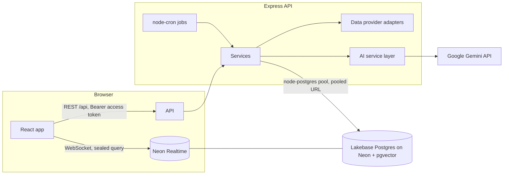

# FINN — Architecture

FINN is a mobile-first investment-intelligence app for ENAM Holdings: portfolio monitoring with materiality-ranked alerts, structured company research, and **Event Memory**, a persistent record of corporate commitments and how they were executed.

## Layout

```
finn-enam/
├── neon.ts                 Neon services: Lakebase Postgres, AI Gateway, Realtime
├── src/                    Frontend (React 18 + Vite + TypeScript + Tailwind + Lucide)
│   ├── lib/api.ts          Central API client: in-memory access token, refresh, retry
│   ├── lib/queries.ts      TanStack Query hooks (cache, invalidation, pagination)
│   ├── lib/live.tsx        Neon Realtime live notifications (polling fallback)
│   ├── screens/            Home · Signals · Research · Event Memory · Settings · Auth
│   └── components/         App shell (header, scrolling content, 5-tab bottom nav), charts, sheets
├── backend/                API (Node + Express 5 + TypeScript + Drizzle ORM)
│   ├── src/config/env.ts   Startup env validation (zod); secrets never logged
│   ├── src/db/             Schema, migrations runner, demo seed
│   ├── drizzle/            SQL migrations (pgvector + 25 tables)
│   ├── src/routes/         REST endpoints
│   ├── src/services/       Alert engine, Event Memory, research, ingestion, auth
│   ├── src/providers/      Provider-independent data adapters (demo today)
│   ├── src/ai/             AI service layer over Google Gemini
│   ├── src/realtime/       Sealed live queries for notifications
│   └── src/jobs/           Scheduled ingestion (node-cron) + CLI
└── scripts/ui-audit.mjs    Responsive audit via Chrome DevTools Protocol
```

## Frontend shell

FINN is a phone app at every viewport (`src/components/layout/AppShell.tsx`):

* A phone: the app fills the screen (`100dvh`, safe-area padding). Anything wider: the same app in a centred, phone-width frame (440 px) at full height on a quieter outer background. There is no sidebar and no desktop layout.
* The frame stacks the header, an independently scrolling content area (`#app-scroll`) and the bottom navigation in one column, so content can never sit under the navigation and the window itself never scrolls.
* The frame is the containing block for overlays: full-screen detail pages and bottom-sheet drawers open inside it (drawers portal into `#app-overlays`).
* Tailwind's window-width breakpoints (`sm`/`md`/`lg`/`xl`) are removed, because inside a phone-width frame they would switch on desktop layouts; only `xs` (375 px) remains for very narrow phones.

## Runtime



* **Database driver.** The API is a long-running process, so it holds one `node-postgres` pool on Neon's pooled (`-pooler`) URL. Migrations use the direct URL (`DATABASE_URL_UNPOOLED`), following Neon guidance.
* **Auth.** Passwords are hashed with Argon2id. Access JWTs last 15 minutes and live in memory only. Refresh tokens are JWTs in an `httpOnly`, `SameSite=Strict` cookie scoped to `/api/auth`, rotated on every use. Only their SHA-256 hash is stored (`auth_sessions`). Replaying a superseded refresh token revokes the session.
* **Same origin.** In development Vite proxies `/api` to `:3001`. In production the API serves the built frontend, so cookies stay `SameSite=Strict`.

## Data integrity rules

1. **Demo is never presented as live.** Every fact table has `is_demo`, and the UI shows a "Demo data" pill wherever demo rows appear. The demo price series is synthetic and labelled as such.
2. **No invented sources.** Fixture "exchange PDF" URLs did not exist, so demo documents are stored with `url = NULL` and a demonstration notice. Fixture quotations attributed to named executives are shown as un-quoted demo text.
3. **Three kinds of claims.** Research claims are typed `reported_fact`, `calculated_metric` (with its formula), `ai_interpretation`, or `analyst_note` (hand-written demo narrative). Sections without support return `unavailable` with a reason.
4. **Evidence-gated outcomes.** An event cannot be marked completed, delayed or abandoned without a source document and an evidence excerpt. Completion also needs an actual date.

## Alert engine

* **Signals** are global facts, one per underlying event, enforced by a unique `dedup_key` such as `price_move:{company}:{date}`, `management_change:{company}:{person}:{role}:{type}`, `financial_result:{company}:{period}`, `announcement:{hash}` or `historical_precedent:{event}:{prior}`. Re-ingesting the same filing or session never creates a second signal.
* Market signals are recorded above a floor (±1% / 1.5×). **User thresholds are applied when notifying.** Notifications are per user, only for companies the user tracks, with `unique(user_id, signal_id)`.
* **Priority:**
  * For price and volume, priority is relative to the user's own threshold: 1× medium, 2× high, 3× critical.
  * For filings, priority comes from a 0–100 materiality score. The score starts from the category's weight and is adjusted for:
    * seniority of the management role
    * the disclosed ₹ amount
    * year-on-year change in results
    * negative keywords
  * Home ranks unread alerts by priority, then materiality, then recency.
* **Changing alert settings** (`PATCH /api/settings/alerts`) immediately re-runs fan-out for that user over the last seven days of signals.

## Event Memory

* **Sources.** Events come from three paths:
  * announcement ingestion: a deterministic tier-0 extractor, plus AI tier-1 when configured; AI-supplied numbers and dates are kept only if they appear in the source text
  * manual entry
  * demo fixtures
* **Lifecycle:** `announced → initiated → in_progress → on_track | delayed → completed | abandoned`, or `outcome_unverified`.
* **Milestones.** Each one stores a date, the resulting status, a description, and its source document or evidence excerpt.
* **Execution records** compute planned vs actual duration, delay in days, capex and capacity variance, and guidance accuracy (`accurate`, `minor_slip`, `major_slip` or `missed`). Per-company reliability rolls these up.
* **Similar-event matching** (`services/similarity.ts`, unit-tested):
  * Structured score:
    * same company: 0.30
    * same category: 0.25
    * same project type: 0.15
    * wording overlap: 0.15
    * capex scale: 0.10
    * same capacity unit: 0.05
  * When both events have embeddings, the semantic score is pgvector cosine similarity (Qwen3 embeddings via the AI Gateway). Combined score = 0.65 × structured + 0.35 × semantic.
  * A candidate must share the company or the category, so embeddings alone never create a match. The threshold is 0.45.
  * When the best match has a known outcome, FINN raises a **"Historical precedent detected"** signal whose explanation is computed from the execution record, for example: *"This company previously announced a similar manufacturing facility in 2023 … expected to complete in 14 months but is running approximately 3 months late."*

## Data providers

`backend/src/providers/types.ts` defines provider-independent contracts for company info, daily market data, announcements, financial statements and transcripts. `registry.ts` selects an adapter per capability from the environment. Today only `demo` ships. A configured but unimplemented name resolves to an adapter that fails loudly, never to fake data.

Adding a licensed NSE/BSE vendor means writing an adapter against its documented API, after reviewing:

* endpoints
* rate limits
* NSE and BSE coverage
* history depth
* licensing

Then register it. No scraping.

## AI service layer

`backend/src/ai/gateway.ts` uses Google Gemini (`@ai-sdk/google`) with AI SDK v6 `generateText({ output: Output.object(schema) })`. Every call:

* receives a numbered evidence pack (E1…En)
* must return zod-validated JSON
* has each claim's citations checked: claims citing unknown ids are discarded

There are two tiers: a fast chat model for extraction and a reasoning model for multi-section research. Without the gateway, AI features report "not configured" rather than producing content.

## Background jobs

| Job | Schedule (IST) | Steps |
| --- | --- | --- |
| `market` | 16:45 and 08:30, weekdays | candles → 20-session volume stats → latest quote → price/volume signals → notifications |
| `announcements` | every 30 min, 08:00–22:00 | fetch → classify → dedupe → source docs → results / management changes → signals → event extraction → similarity → precedent alerts → notifications |

Runs are recorded in `job_runs`, and a job never overlaps itself. Run one manually with `npm --prefix backend run jobs:run -- market`.
